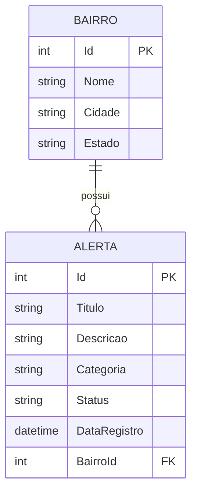

# AlertaBairro

API REST da solução CitizenTech **AlertaBairro**, voltada ao registro de alertas
comunitários associados a bairros.

## Integrantes

- Preencher com nome e RM
- Preencher com nome e RM

## Tecnologias

- ASP.NET Core 8 Web API com controllers
- Entity Framework Core 8
- Oracle Database
- Migrations do Entity Framework Core

## Modelo de dados



Um bairro pode possuir vários alertas, e cada alerta pertence a um único bairro.

## Pré-requisitos

- .NET 8 SDK
- Acesso ao Oracle da FIAP
- Git

## Configuração da conexão

A aplicação não armazena credenciais no repositório. Configure a connection
string por variável de ambiente.

No PowerShell:

```powershell
$env:ConnectionStrings__Oracle = "User Id=SEU_USUARIO;Password=SUA_SENHA;Data Source=oracle.fiap.com.br:1521/ORCL"
```

## Executar o projeto

Na raiz do repositório:

```powershell
dotnet restore AlertaBairro.sln
dotnet build AlertaBairro.sln
dotnet run --project src\AlertaBairro.Api\AlertaBairro.Api.csproj
```

## Aplicar as Migrations

O manifesto local contém a ferramenta `dotnet-ef`. Para restaurá-la:

```powershell
dotnet tool restore
```

Depois de configurar `ConnectionStrings__Oracle`, aplique a Migration:

```powershell
dotnet tool run dotnet-ef database update `
  --project src\AlertaBairro.Infrastructure\AlertaBairro.Infrastructure.csproj `
  --startup-project src\AlertaBairro.Api\AlertaBairro.Api.csproj
```

As Migrations ficam versionadas em:

```text
src\AlertaBairro.Infrastructure\Persistence\Migrations
```

## Rotas

### Bairros

```text
GET    /api/bairros
GET    /api/bairros/{id}
POST   /api/bairros
PUT    /api/bairros/{id}
DELETE /api/bairros/{id}
```

Exemplo de criação:

```powershell
curl.exe -X POST http://localhost:5000/api/bairros `
  -H "Content-Type: application/json" `
  -d '{\"nome\":\"Moema\",\"cidade\":\"São Paulo\",\"estado\":\"SP\"}'
```

### Alertas

```text
GET    /api/alertas
GET    /api/alertas/{id}
POST   /api/alertas
PUT    /api/alertas/{id}
DELETE /api/alertas/{id}
```

Exemplo de criação:

```powershell
curl.exe -X POST http://localhost:5000/api/alertas `
  -H "Content-Type: application/json" `
  -d '{\"titulo\":\"Alagamento\",\"descricao\":\"Rua com ponto de alagamento\",\"categoria\":\"Infraestrutura\",\"status\":\"Aberto\",\"bairroId\":1}'
```

O `POST` de alerta retorna `404` se o `bairroId` não existir.
Dados inválidos retornam `400` em JSON. Consultas, alterações ou exclusões
com ID inexistente retornam `404`.
